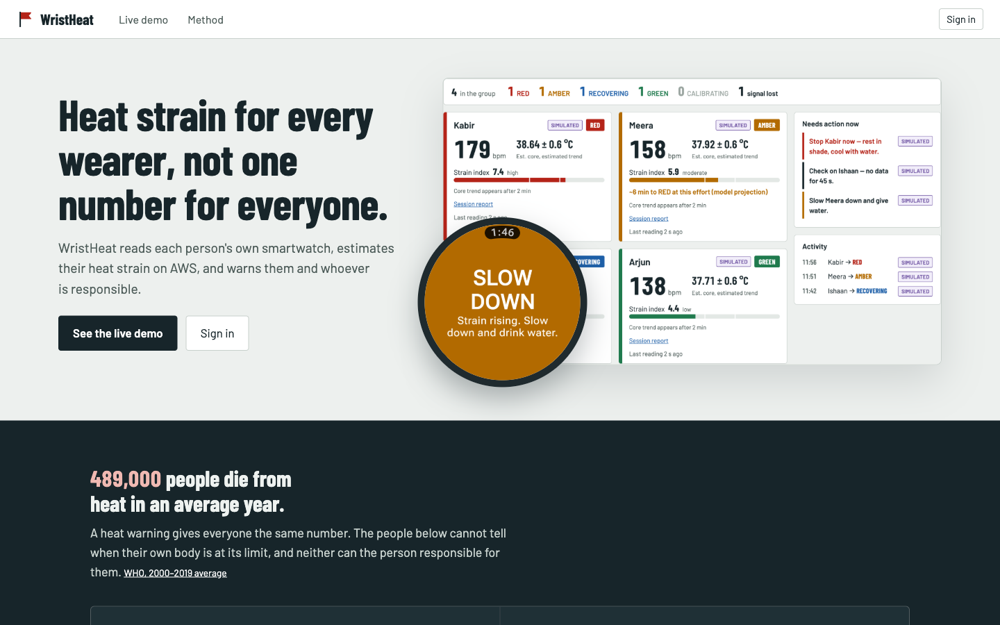
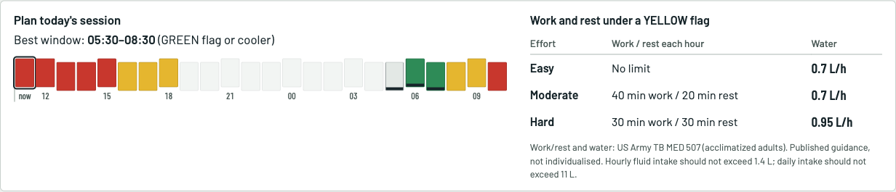
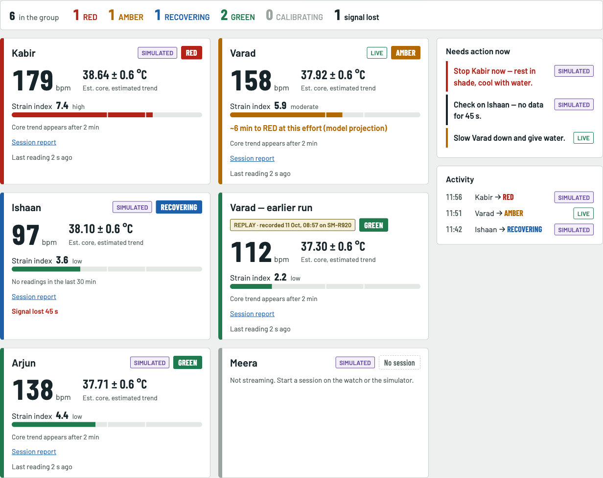
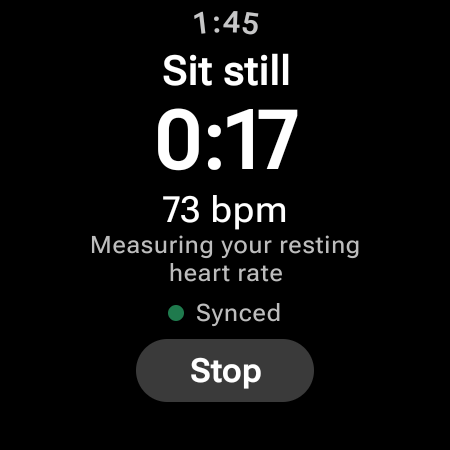
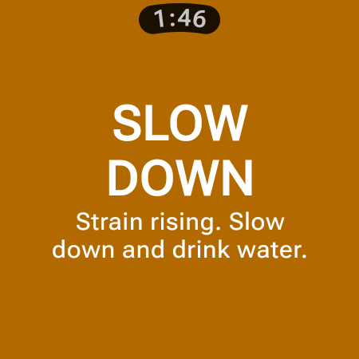
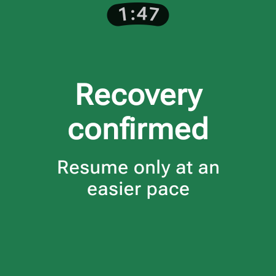
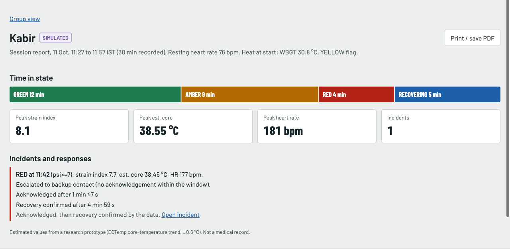
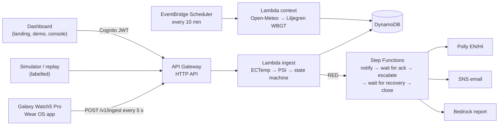

# WristHeat

**Heat strain for every wearer, not one number for everyone.**

WristHeat reads each person's own smartwatch, estimates their heat strain on AWS, and warns them and whoever is responsible: a runner on their own, or the supervisor of a group exerting in heat, before, during and after the session.

Built for **AWS Environmental Hacks 2026** (Heat & Water track). Research prototype, not a medical device.

| | |
|---|---|
| **Live site** | https://vvs0o13cs4.execute-api.ap-south-1.amazonaws.com |
| **Public demo** (simulated group, no sign-in) | https://vvs0o13cs4.execute-api.ap-south-1.amazonaws.com/demo |
| **How the estimate works** | https://vvs0o13cs4.execute-api.ap-south-1.amazonaws.com/method |
| **Sign in** | `/console` (Cognito). Supervisors get the group console; a solo wearer is sent to their own page at `/me` |



## Why

About **489,000 people die from heat in an average year** ([WHO](https://www.who.int/news-room/fact-sheets/detail/climate-change-heat-and-health), 2000–2019). A heat warning gives everyone in a place the same number. The person exerting cannot tell when *their own* body is at its limit, and neither can the person responsible for them.

| Who | What happened | Source |
|---|---|---|
| Outdoor and manual workers | 2.41 billion workers face excessive heat; about 19,000 die and 22.85 million are injured each year | [ILO, 2024](https://www.ilo.org/publications/ensuring-safety-and-health-work-changing-climate) |
| School children | 23 students collapsed after a morning assembly in Chitrakoot, UP (Aug 2024); students fainted at assemblies across Bihar in May | [Careers360](https://news.careers360.com/uttar-pradesh-23-students-faint-at-school-in-ups-chitrakoot-due-heat) |
| Recruitment and military training | 12 candidates died on a 10 km excise constable recruitment run in Jharkhand (2024); the US armed forces logged 471 heat strokes that year | [Deccan Herald](https://www.deccanherald.com/amp/story/india%2Fjharkhand%2Fhumidity-lack-of-health-screening-change-in-rules-some-reasons-behind-12-deaths-at-jharkhand-recruitment-drive-report-3181567), [MSMR, June 2025](https://health.mil/News/Articles/2025/06/01/MSMR-Heat-Illness-2025) |
| Pilgrims, runners and crowds | 1,301 deaths during the 2024 Hajj in heat up to 51.8 °C; the 2007 Chicago Marathon was halted | [Hajj 2024 summary](https://en.wikipedia.org/wiki/2024_Hajj_extreme_heat_disaster) |
| India, summer 2024 | 40,984 suspected heatstroke cases and 114 deaths, 1 March to 18 June, hospital reporting only | [NCDC via South First](https://thesouthfirst.com/health/summers-wrath-114-heatwave-deaths-reported-nearly-41000-cases-of-suspected-heatstroke) |

## Two ways to use it

| | On your own (solo) | With a group |
|---|---|---|
| Who | A runner, hiker or lone worker | A coach, PE teacher, drill instructor or site supervisor |
| Sign-in | Cognito group `wearers`, sees only their own data at `/me` | Cognito group `supervisors`, sees the whole group at `/console` |
| On RED | The watch alerts the wearer; a button on `/me` confirms "I've stopped and I'm cooling down" | The supervisor is emailed with a voice alert and acknowledges in the console |
| No response in 90 s | The wearer's emergency contact is emailed | The backup contact is emailed |
| Afterwards | Personal run history and session reports | Command view, incident log and session reports |

Solo wearers never appear in the group roster or the public demo, and a wearer sign-in gets `403` on every group route.

## What it does

### Before the session: plan around the heat
A 24-hour heat-flag forecast for the site (Liljegren WBGT from Open-Meteo), the best window to train, and the US Army TB MED 507 work/rest and water guidance for today's flag.



### During the session: know who to stop
Each Galaxy Watch streams heart rate every 5 seconds. WristHeat estimates a core-temperature trend (ECTemp Kalman filter) and a Physiological Strain Index, vibrates the wrist on a state change, and gives the supervisor a command view: status counts, **Needs action now** in plain words, and an activity feed.



| Calibrating | Slow down (AMBER) | Recovery confirmed |
|---|---|---|
|  |  |  |

### After the session: keep the record
A RED state opens an incident. Step Functions emails the supervisor with an English and Hindi voice alert (Amazon Polly), escalates to a backup contact if nobody acknowledges within 90 s, and closes the incident **only when the data confirms recovery**. Every session prints as a duty-of-care report.



## How it works



More detail: [`docs/architecture.md`](docs/architecture.md). The risk engine is pure Python (`backend/src/wristheat/{ectemp,strain,engine}.py`) with no AWS imports and is tested against published golden values.

### AWS services and the job each one does

| Service | Job |
|---|---|
| API Gateway (HTTP API) | Receives the watch stream; JWT-protects supervisor routes; serves the dashboard |
| Lambda (Python 3.12, arm64) | Runs the risk engine, context fetch, workflow steps, supervisor API |
| DynamoDB (on-demand, TTL) | Stores readings, per-minute estimates, session state, incidents, sites |
| Step Functions (Standard) | Escalation: notify → wait for acknowledgement → escalate → wait for confirmed recovery → close |
| EventBridge Scheduler | Refreshes site heat and air every 10 min |
| Amazon Polly (neural Kajal, en-IN + hi-IN) | Spoken alert in English and Hindi |
| Amazon SNS (email) | Alerts the supervisor, then the backup contact (or a solo wearer's emergency contact) |
| Amazon Bedrock (Converse, Nova Lite via APAC profile) | Writes the incident report from logged facts only (template fallback) |
| Amazon S3 | Alert audio |
| Amazon CloudFront | Dashboard CDN when enabled (`-c cloudFront=true`); see Known limits |
| Amazon Cognito | Sign-in with two groups: `supervisors` (group console) and `wearers` (own data only) |
| AWS Secrets Manager | Holds the device token |
| CloudWatch + X-Ray (Powertools for AWS Lambda) | Logs, custom metrics, a `WristHeat` dashboard, traces |
| AWS CDK (TypeScript) / CloudFormation | The entire stack as code, one deploy command |

## Repository

```
backend/     Python package `wristheat`: engine, contract, Lambda handlers, pytest suite
infra/       AWS CDK app (TypeScript) with assertion tests
dashboard/   React + Vite app: landing, public demo, supervisor console (vitest)
wear/        Galaxy Watch (Wear OS) app: Kotlin, Health Services, Compose for Wear OS
simulator/   Labelled simulator, session export and replay
scripts/     build, deploy, seed and smoke scripts
contracts/   JSON Schemas and examples shared by the watch and the cloud
docs/        Spec, plans, architecture, research ([index](docs/README.md))
```

## Quick start

Prerequisites: AWS credentials for `ap-south-1` (`aws login`), Node ≥ 20, Python 3.12, [uv](https://docs.astral.sh/uv/). No Docker.

```bash
# Tests
python3.12 -m venv .venv && uv pip install --python .venv/bin/python -r backend/requirements-dev.txt
make test                                  # engine, API, escalation, simulator
(cd infra && npm ci && npm test)           # CDK assertions
(cd dashboard && npm ci && npm test)       # dashboard

# Deploy (emails in a git-ignored .env.deploy: WH_SUPERVISOR_EMAIL=…, WH_BACKUP_EMAIL=…)
bash scripts/deploy.sh                     # bootstraps CDK if needed, builds layers + dashboard, deploys
.venv/bin/python scripts/seed.py --name "<wearer>" --age <n> --supervisor-email <email> \
    --wearer-username <name> --wearer-email <email>   # optional: solo wearer sign-in linked to T1
.venv/bin/python scripts/smoke.py          # → OK GREEN
```

Confirm both SNS subscription emails once. Watch setup is in [`wear/README.md`](wear/README.md) (`wear/local.properties`: API URL, device token, trainee id; never committed).

**Simulator** (labelled SIMULATED everywhere):
```bash
.venv/bin/python simulator/simulate.py --only S3 --backfill-minutes 18 --surge-after 30   # escalation demo
.venv/bin/python simulator/simulate.py --only S3 --profile easy96                         # S3 recovers, incident closes
```

## Honesty

1. "WristHeat estimates a core-temperature *trend* from heart rate using ECTemp (US Army Research Institute of Environmental Medicine). It is not a thermometer and not a medical device."
2. "ECTemp was validated with chest-strap heart rate (about ±0.6 °C). It has not been validated on wrist optical sensors like the one in this watch, and studies found it misses many cases above 39 °C. Treat it as an early indicator, never as clearance to continue."
3. "WBGT is computed for open ground in sun from Open-Meteo forecast data (Liljegren method). Shade, indoor and local conditions differ."
4. "The rules that combine strain with the heat flag are our own heuristic, not a published standard."
5. "Trainees marked SIMULATED are generated by our simulator. REPLAY shows a real session recorded earlier. LIVE is a real person wearing the watch now."
6. "ECTemp is patented (US 10702165). This is a non-commercial research prototype."

Work/rest and water guidance is the published US Army TB MED 507 table for acclimatized adults; WristHeat does not individualise it. We do not claim any prevented illness, clinical accuracy or measured impact.

## Data attribution

- Weather data by Open-Meteo.com (CC BY 4.0)
- Air quality: Copernicus Atmosphere Monitoring Service via Open-Meteo

## AI tools used

- **Claude (Claude Code)** for research, design, the cloud backend, dashboard, simulator, tests and the Wear OS app.
- **Amazon Bedrock (Nova Lite)** at runtime, only to word the incident report from logged facts; a deterministic template is used if it is unavailable.

## Known limits

- **CloudFront:** blocked on our new AWS account pending verification, so the dashboard is served by API Gateway + Lambda over HTTPS. The CloudFront path is in the stack behind `-c cloudFront=true`.
- **Bedrock:** also pending account verification during the event; reports fall back to the labelled template.
- The incident list uses a DynamoDB Scan with a filter (fine below ~1,000 incidents).
- WBGT is open-field in sun from forecast data, not a measurement at the athlete's location.
- ECTemp is unvalidated on wrist optical heart rate; the ± 0.6 °C band is the chest-strap figure.
- One site per deployment; one shared device token.

Sources and licences: [`CREDITS.md`](CREDITS.md). Licence: MIT.
