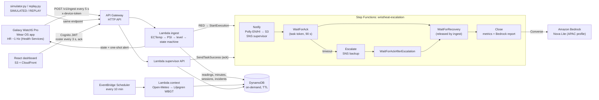

# WristHeat architecture

The risk engine is pure Python (`backend/src/wristheat/{ectemp,strain,engine}.py`) with no AWS imports, so it is tested offline against the golden values in the spec (§7).
